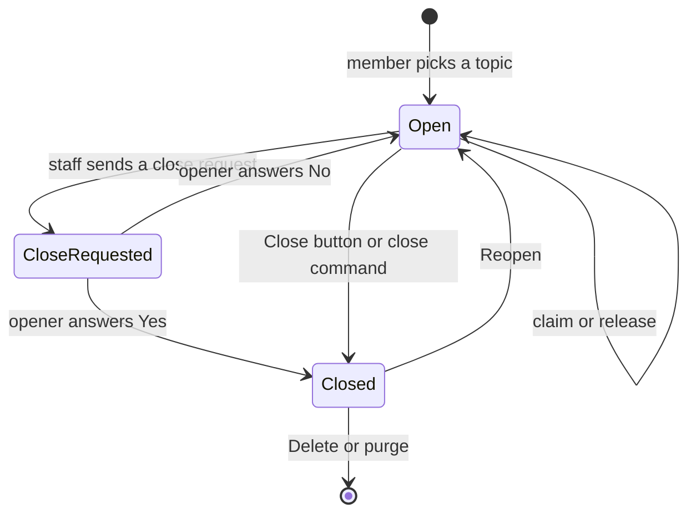
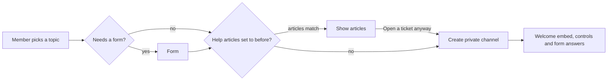

<div align="center">

# :ticket: Ticket Bot

**A fast, self-hosted Discord ticket system with multi-topic panels, staff applications, star ratings, help articles and HTML transcripts.**

[](https://nodejs.org)
[](https://discord.js.org)
[](https://github.com/WiseLibs/better-sqlite3)
[](#why-its-fast)
[](LICENSE)

[Features](#features) | [Quick start](#quick-start) | [Guide](#usage-guide) | [Commands](#command-reference) | [Architecture](#architecture) | [Deployment](#deployment) | [Troubleshooting](#troubleshooting)

</div>

---

## Overview

Ticket Bot gives your members a private channel with your staff in one click. You post a **panel** (a message with buttons or a dropdown) and members open tickets from it. Each entry on the panel, called a **topic**, can be routed to its own staff role, category, form and transcript channel, or turned into a staff **application**.

It runs on a single process with an embedded SQLite database. There is nothing else to host, no web dashboard to secure, and no privileged intents to enable.

## Features

| | |
| --- | --- |
| :jigsaw: **Three panel styles** | `click` (button), `form` (button + form) and `sidebar` (dropdown menu) |
| :card_index_dividers: **Multi-topic panels** | Up to 25 buttons or dropdown entries on one panel, added with `/topic add` |
| :twisted_rightwards_arrows: **Per-topic routing** | Each topic can have its own staff role, Discord category, transcript channel, ticket limit, ticket message and form questions |
| :memo: **Staff applications** | A topic can be an application: custom form, private review channel, **Accept** (grants a role) / **Deny** (with reason), applicant notified by DM |
| :raising_hand: **Claiming** | Staff claim and release tickets. Optional per panel |
| :white_check_mark: **Close requests** | Staff ask the opener to confirm the issue is resolved; only the opener can answer |
| :star: **Ratings** | After close, the opener gets a DM with 1 to 5 stars and an optional comment, delivered to staff |
| :books: **Help articles** | Built-in knowledge base. Suggest answers before a ticket opens or inside it, and look them up with `/faq` |
| :page_facing_up: **HTML transcripts** | Dark-theme single-file transcript with attachments, embeds and markdown, sent to a channel and DMed to the opener |
| :repeat: **Reopen / delete / purge** | Reopen closed tickets, delete with a countdown, or bulk purge with a confirmation step |
| :shield: **Safe by default** | Double-click protection, creation cooldown, per-topic ticket limits, atomic application decisions, permission checks on every action |
| :zap: **Lean** | `Guilds` intent only, tight caches, prepared statements, commands re-registered only when they change |

## How it works



When a ticket closes, the bot locks the opener out of typing, builds the transcript and sends the rating prompt at the same time.



**Panels and topics.** A panel is the message members click. A topic is one button (or one dropdown entry) on it. Anything you leave empty on a topic falls back to the panel's setting, so a basic panel needs no per-topic configuration at all.

## Quick start

### Prerequisites

- **Node.js 20 or newer**
- A Discord account with permission to add a bot to your server
- Build tools are only needed if no prebuilt `better-sqlite3` binary exists for your platform (see [Troubleshooting](#troubleshooting))

### 1. Create the bot

1. Open the [Discord Developer Portal](https://discord.com/developers/applications) and create a **New Application**.
2. Go to **Bot**, then **Reset Token**, and copy the token. Keep it secret.
3. You do **not** need to turn on any privileged intents.

### 2. Invite it

Replace `YOUR_CLIENT_ID` with your application's ID (**General Information**):

```
https://discord.com/oauth2/authorize?client_id=YOUR_CLIENT_ID&permissions=268561424&scope=bot%20applications.commands
```

That link requests the permissions below. If you build your own invite, grant at least these:

| Permission | Why it is needed |
| --- | --- |
| Manage Channels | Create and delete ticket channels, change who can type |
| View Channels, Send Messages, Embed Links | Post panels and ticket messages |
| Attach Files | Upload transcripts |
| Read Message History | Build transcripts |
| Manage Messages | Lets staff manage messages inside tickets. A bot can only grant permissions it has itself |
| Manage Roles | Only for applications that grant a role when accepted. Its role must sit **above** that role |

### 3. Install and run

```bash
git clone https://github.com/Just9OO/Discord-Ticket-Bot
cd ticket-bot
npm install
cp .env.example .env      # then edit .env and paste your token
npm start
```

On the first start the bot creates `data/tickets.db` and registers its slash commands. While testing, set `GUILD_ID` so commands appear instantly instead of after up to an hour.

### 4. Post your first panel

```text
/panel type:click channel:#support staff_role:@Support message:"Need help? Press the button below."
```

Then add more entries with `/topic add` (see the [usage guide](#usage-guide)).

## Configuration

Settings come from environment variables, loaded from `.env`.

| Variable | Required | Default | Description |
| --- | :---: | --- | --- |
| `DISCORD_TOKEN` | :white_check_mark: | | Your bot token |
| `GUILD_ID` | | *(global)* | Register slash commands to this one server. Instant, good for testing. Leave empty for a public bot |
| `DB_PATH` | | `./data/tickets.db` | Where the SQLite database is stored |
| `MAX_TRANSCRIPT_MESSAGES` | | `5000` | Messages included in one transcript. Longer tickets keep the most recent ones |
| `CREATE_COOLDOWN_SECONDS` | | `10` | Seconds a member must wait between opening tickets |

## Usage guide

### Panel types

| Type | What members see | Best for |
| --- | --- | --- |
| `click` | One button per topic. Clicking opens a ticket straight away | Simple support |
| `form` | One button per topic. Clicking opens a form first (subject and details, or the topic's own questions) | Collecting details up front |
| `sidebar` | One dropdown menu listing the topics | Many categories in little space |

### Topics: several ticket types on one panel

`/panel` creates the panel with its first topic. `/topic add` adds more, each with only the settings that differ:

```text
/panel type:click channel:#support staff_role:@Support message:"How can we help?" label:"General help"

/topic add panel:1 label:"Refunds" questions:"Order number?|What went wrong?" staff_role:@Billing discord_category:Billing max_tickets:2

/topic add panel:1 label:"Report a member" staff_role:@Moderators discord_category:Reports transcript_channel:#mod-logs
```

Use `/topic edit` to change one (type `none` to clear a value, or `reset:true` to make it follow the panel again), `/topic list` to review them, and `/topic remove` to delete one. Changes update the panel message automatically.

### Staff applications

Set `kind:application` on a topic. Members fill in its questions, the bot opens a private channel with their answers, and staff decide with buttons:

```text
/topic add panel:1 label:"Apply for staff" kind:application questions:"Why do you want to join?|How old are you?|Past experience?" accept_role:@Trial staff_role:@Admins
```

- **Accept** grants `accept_role` (if set) and notifies the applicant in the channel and by DM.
- **Deny** asks the reviewer for an optional reason, which is sent to the applicant.
- A decision can only be made once, even if two reviewers press a button at the same moment.
- Applications use `app-0001` style channel names and are not rated.

### Help articles

Write articles with `/kb add`, which opens a form for a title, comma-separated keywords and the answer. Articles are matched in two ways:

1. **Linked to a topic** with `/kb link`. Always suggested for that topic.
2. **Matched by keywords** against what the member wrote in the form. No external service is involved.

Set `help_articles` on `/panel` to choose when members see them: `inside` the new ticket (default), `before` the ticket is created (with **That solved it** and **Open a ticket anyway** buttons), or `off`. Anyone can use `/faq` to look an article up. Each server can hold up to 100 articles.

### Close requests

A staff member runs `/close-request [message]` in a ticket. The opener gets **Yes, close it** and **No, keep it open** buttons. Only the opener can answer. Yes closes the ticket with the reason "Resolved: confirmed by the ticket opener".

### Ratings

When a ticket closes, the opener receives a DM with five star buttons and an optional comment form. The rating is posted to the topic's transcript channel along with who handled the ticket.

- Needs a transcript channel on the panel or topic, because that is where ratings are delivered.
- Each ticket is asked once, even if it is reopened and closed again.
- If the opener's DMs are closed, the prompt is posted in the ticket channel instead.
- Turn it off per panel with `survey:false`.

### Transcripts

With a transcript channel set, closing (or deleting) a ticket sends a single `.html` file to that channel and to the opener. It includes message grouping, markdown, code blocks, attachments, embeds and stickers, and opens in any browser with no server needed. Images load from Discord's CDN, so they can stop displaying in very old transcripts.

## Command reference

### Setup (requires Manage Server)

| Command | Description |
| --- | --- |
| `/panel` | Post a ticket panel with its first topic |
| `/topic add` | Add a button or dropdown entry to a panel |
| `/topic edit` | Change a topic |
| `/topic remove` | Remove a topic (a panel always keeps at least one) |
| `/topic list` | Show the topics of one panel or all panels |
| `/kb add` | Write a help article in a form |
| `/kb remove`, `/kb list` | Delete or list articles |
| `/kb link`, `/kb unlink` | Always suggest an article for one topic, or stop doing so |

### Inside a ticket

| Command | Who | Description |
| --- | --- | --- |
| `/claim` | Staff | Claim the ticket. Run again to release it |
| `/close [reason]` | Opener or staff | Close the ticket. Works even if the Close button does not |
| `/close-request [message]` | Staff | Ask the opener to confirm the issue is resolved |
| `/add-user <user>` | Staff | Give a member access to the ticket |
| `/remove-user <user>` | Staff | Remove a member who was added |
| `/rename <name>` | Staff | Rename the channel |
| `/delete` | Staff | Delete the channel after a 5 second countdown |

### Everyone

| Command | Description |
| --- | --- |
| `/faq <article>` | Look up a help article. Pick from the list or type a few words |
| `/ping` | Show API and gateway latency |
| `/help` | List the commands |

### Admin

| Command | Description |
| --- | --- |
| `/purge [scope]` | Bulk-delete `closed` (default) or `all` ticket channels. Asks for confirmation and does not create transcripts. **Administrator only** |

**Staff** means the topic's (or panel's) staff role, or anyone with Administrator or Manage Channels.

### `/panel` options

| Option | Required | Description |
| --- | :---: | --- |
| `type` | :white_check_mark: | `click`, `form` or `sidebar` |
| `channel` | :white_check_mark: | Where to post the panel |
| `staff_role` | :white_check_mark: | Role that can see and manage tickets |
| `message` | :white_check_mark: | Panel embed text. Type `\n` for a new line |
| `ticket_message` | | Embed text shown inside each new ticket |
| `claim_button` | | Show Claim / Release inside tickets (default on) |
| `transcript_channel` | | Where transcripts and ratings are sent |
| `category` | | Discord category for ticket channels (default: next to the panel channel) |
| `title`, `color` | | Panel embed title and hex color, for example `#5865F2` |
| `label` | | Button text of the first topic (default: Open a Ticket) |
| `categories` | | `sidebar` only: comma-separated dropdown entries, max 25 |
| `max_tickets` | | Open tickets allowed per member in each topic (default 1) |
| `survey` | | Send a rating DM after close (default on) |
| `help_articles` | | `inside` (default), `before` or `off` |

### `/topic add` and `/topic edit` options

| Option | Description |
| --- | --- |
| `panel`, `label` | Required for `add`. `edit` needs `panel` and `topic` |
| `kind` | `ticket` (default) or `application` |
| `emoji`, `description` | Shown on the button or dropdown entry |
| `staff_role`, `discord_category`, `transcript_channel`, `max_tickets`, `ticket_message` | Override the panel's settings for this topic |
| `questions` | Form questions separated by `\|`. Up to 5, 45 characters each. Applications need at least one |
| `accept_role` | Applications only: role given to accepted applicants |
| `reset` | `edit` only: clear this topic's overrides first |

## Architecture

### Project structure

```text
ticket-bot/
|-- src/
|   |-- index.js            # Client setup, cache limits, startup, shutdown
|   |-- config.js           # Environment variables and constants
|   |-- db.js               # Opens SQLite, prepares every statement once
|   |-- sql.js              # Schema, migrations and all SQL (no driver imports)
|   |-- deploy.js           # Registers slash commands only when they changed
|   |-- handlers.js         # Routes interactions to commands and button/modal handlers
|   |-- actions.js          # Shared logic for slash commands and buttons
|   |-- tickets.js          # Open, close, reopen, delete, permissions
|   |-- topics.js           # Topic settings, inheritance from the panel, form questions
|   |-- survey.js           # Rating prompts and delivery
|   |-- knowledge.js        # In-memory help-article search
|   |-- transcript.js       # Collects messages over REST and delivers the file
|   |-- transcriptHtml.js   # Pure HTML renderer for transcripts
|   |-- autocomplete.js     # Autocomplete for panels, topics and articles
|   |-- ui.js               # Every embed, button, dropdown and modal
|   `-- commands/           # One file per slash command, loaded automatically
|-- .env.example
|-- package.json
`-- README.md
```

Adding a command means adding one file to `src/commands/` that exports `data` (a `SlashCommandBuilder`) and `execute(interaction)`. It is picked up on the next start.

### Why it's fast

- **`Guilds` intent only.** Slash commands, buttons, dropdowns and forms all arrive as interactions. Transcripts are read over REST. The bot never receives message, member or presence events.
- **Tight caches.** Messages, reactions, presences, threads, emojis and similar are not cached, and users and members are capped.
- **SQLite in WAL mode.** Every statement is compiled once at startup, and the hot lookups (channel to ticket, a member's open tickets) are indexed.
- **Commands register only on change.** A hash of the command definitions is stored in the database, so a normal restart makes no registration calls.
- **Work in parallel.** Closing a ticket builds the transcript, locks the opener and sends the rating prompt concurrently.
- **Nothing is built unless it is used.** No transcript channel means no transcript work. Help-article search runs from an in-memory index that is rebuilt only when articles change.

### Database

| Table | Purpose |
| --- | --- |
| `panels` | Posted panels and their default settings |
| `topics` | Buttons or dropdown entries, with optional overrides |
| `tickets` | Every ticket and application, including claim, close and decision state |
| `surveys` | Rating prompts and answers. Kept after the ticket is deleted |
| `kb_articles` | Help articles |
| `counters` | Per-server ticket numbers, never reused |
| `meta` | Internal values such as the command definition hash |

The schema lives in [`src/sql.js`](src/sql.js). Columns added after the first release are applied by a small migration step on startup, so an existing database is upgraded in place and old panels keep working.

### Custom IDs

Every component ID starts with `tk:` followed by an action and its arguments, for example `tk:t:12` (topic 12), `tk:rate:3:5` (survey 3, five stars) or `tk:app:accept`. IDs are routed in [`src/handlers.js`](src/handlers.js). Button state lives in the database, not in the ID, so panels and tickets keep working across restarts. Only short-lived prompts, such as the help-article gate, are held in memory and expire after 10 minutes or on restart.

## Deployment

The bot is one Node process and one SQLite file. Any host that keeps a persistent disk works.

### Process manager

```bash
npm install -g pm2
pm2 start src/index.js --name ticket-bot
pm2 save && pm2 startup
```

### systemd

```ini
# /etc/systemd/system/ticket-bot.service
[Unit]
Description=Ticket Bot
After=network-online.target

[Service]
WorkingDirectory=/opt/ticket-bot
ExecStart=/usr/bin/node src/index.js
Restart=always
User=ticketbot

[Install]
WantedBy=multi-user.target
```

### Data and backups

- All state is in `data/tickets.db` (set `DB_PATH` to move it). On container or PaaS hosts, put it on a **persistent volume**, otherwise tickets are lost on redeploy.
- Back it up while running with `sqlite3 data/tickets.db ".backup 'backup.db'"`.
- The bot checkpoints the WAL file and closes the database on `SIGINT` and `SIGTERM`.

### Updating

```bash
git pull
npm install
# restart the process
```

Database changes are migrated automatically on startup, and slash commands are re-registered if their definitions changed.

## Troubleshooting

<details>
<summary><b>Slash commands don't appear</b></summary>

Global commands can take up to an hour to show up. Set `GUILD_ID` in `.env` to register to one server instantly. Also check the bot was invited with the `applications.commands` scope.
</details>

<details>
<summary><b>"I could not create your ticket"</b></summary>

The bot is missing **Manage Channels**, or the category is full (Discord allows 50 channels per category and 500 per server). Use `category` or `discord_category` to point at a category with room.
</details>

<details>
<summary><b>I cannot send embeds / files in that channel</b></summary>

`/panel` and `/topic` check the bot's permissions in the target channels. Grant View Channel, Send Messages and Embed Links, plus Attach Files for the transcript channel.
</details>

<details>
<summary><b>Accepted applicants don't get their role</b></summary>

The bot needs **Manage Roles**, and its highest role must be **above** the role it is giving. Move the bot's role up in **Server Settings > Roles**. Staff also see this in the ticket when it happens.
</details>

<details>
<summary><b>Ratings or transcripts aren't arriving</b></summary>

Ratings are delivered to the transcript channel, so set one on the panel or topic. Transcripts are also DMed to the opener, which fails silently if their DMs are closed.
</details>

<details>
<summary><b><code>npm install</code> fails on better-sqlite3</b></summary>

`better-sqlite3` ships prebuilt binaries for common Node versions and platforms. If none matches yours, it compiles from source, which needs Python 3 and a C++ toolchain (`build-essential` on Debian and Ubuntu, Xcode command line tools on macOS). Using an LTS version of Node 20 or newer avoids this in most cases.
</details>

<details>
<summary><b>Renaming a ticket seems slow</b></summary>

Discord allows only 2 channel renames per 10 minutes per channel. `/rename` tells you when the change is queued.
</details>

## Limits to know about

| Limit | Value | Source |
| --- | --- | --- |
| Topics per panel | 25 | One dropdown, or 5 rows of 5 buttons |
| Form questions per topic | 5, 45 characters each | Discord form limits |
| Help articles per server | 100 | Keeps the in-memory index small |
| Transcript size | `MAX_TRANSCRIPT_MESSAGES` (5000) | Configurable |
| Attachment links in transcripts | Expire eventually | Discord CDN links are not permanent |

## Roadmap

Ideas that are not built yet, in no particular order:

- [ ] Auto-close inactive tickets
- [ ] Priority levels
- [ ] Support hours per panel
- [ ] Staff statistics and a leaderboard
- [ ] Open a ticket from a message (context menu)
- [ ] Private threads instead of channels
- [ ] Ticket log channel and member blacklist

## Contributing

Issues and pull requests are welcome.

1. Fork the repo and create a branch: `git checkout -b feature/my-change`
2. Install and run locally with a test server: set `GUILD_ID` in `.env` and run `npm run dev`
3. Keep to the existing style: CommonJS, no build step, and all SQL in `src/sql.js` as prepared statements
4. Open a pull request describing what changed and how you tried it

## Security

- Never commit `.env`. It is in `.gitignore`.
- If your token leaks, reset it in the Developer Portal right away.
- To report a vulnerability, please open a private security advisory on GitHub rather than a public issue.

## License

Released under the [MIT License](LICENSE).

Built with [discord.js](https://discord.js.org) and [better-sqlite3](https://github.com/WiseLibs/better-sqlite3).
